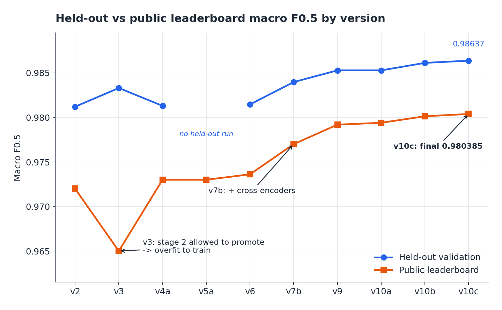
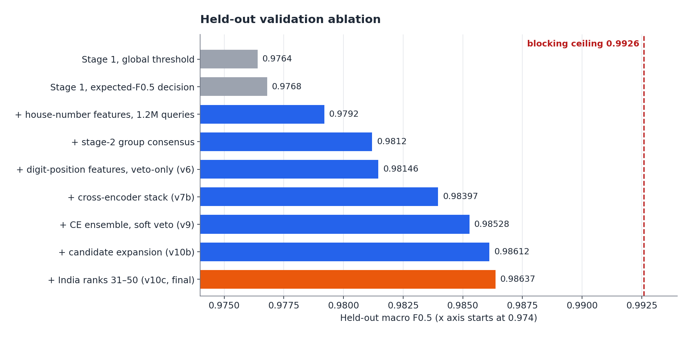
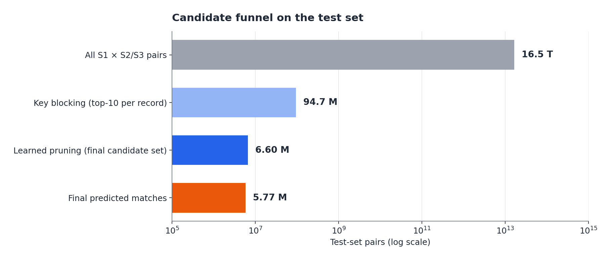
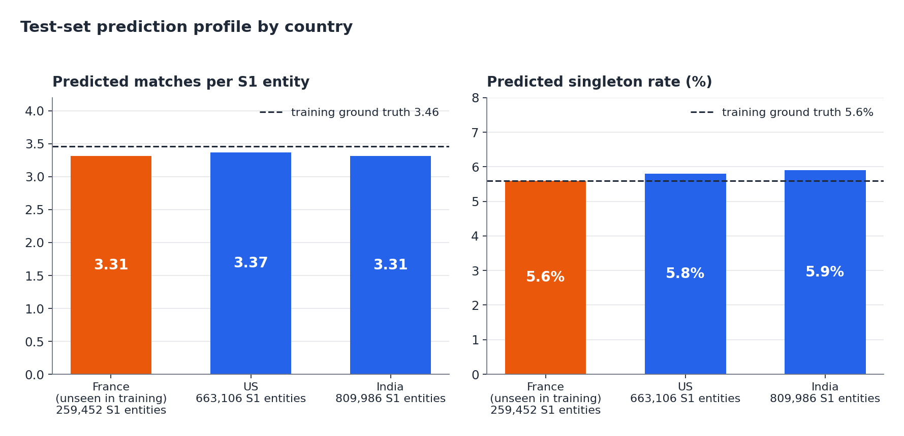
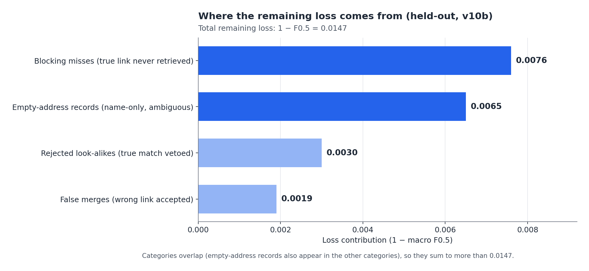

<div align="center">

# Business Entity Resolution at 12-Million-Record Scale

**Matching noisy business records across three independent sources, in three countries and eight scripts, on a laptop CPU.**

*Amazon ML Challenge 2026 · Team Vyrox · B Sujan Kumar & Apeksha Sanjay Hudali*

[](https://github.com/BSujanK/EntityResolution-AmazonML/actions/workflows/ci.yml)


[](LICENSE)

</div>

---

## At a glance

| | |
|---|---|
| **Task** | For each of **1.73 M** Source-1 business entities, find every matching record among **~10 M** noisy Source-2 / Source-3 records |
| **Metric** | Macro **F0.5** per Source-1 entity (precision counts twice as much as recall; singletons included) |
| **Public leaderboard** | **0.980385** (final submission, v10c) |
| **Held-out validation** | **0.98637** macro F0.5 on 441,785 never-trained-on Source-1 entities (US 0.98860 · India 0.98302) |
| **Blocking ceiling** | 0.9926: what a perfect matcher could score on our candidate set |
| **Search-space reduction** | 1.65 × 10¹³ possible pairs → 94.7 M blocked → **6.60 M candidates** (3.81 per S1 entity, 99.99996 % pruned) → 5.77 M predicted links |
| **Unseen country** | France is absent from training, yet its predictions match the training distribution: 3.31 links per entity and 5.6 % singletons, against 3.46 and 5.6 % in the training ground truth |
| **Models** | 2-fold cross-fitted LightGBM (72 features) · 4 fine-tuned MiniLM-L6 cross-encoders (22.7 M params) · LightGBM stacker · group-level twin-veto model |
| **Compute** | One Intel i7-1355U laptop (10 cores / 12 threads), 16 GB RAM, **no GPU**; peak RAM ≈ 9 GB |
| **External data** | None. No lookups, no APIs, no geocoding (as the challenge rules require) |

<p align="center">
  
</p>

---

## Contents

1. [The problem](#1-the-problem)
2. [System architecture](#2-system-architecture)
3. [How it works: the deep dive](#3-how-it-works-the-deep-dive)
4. [Results in numbers](#4-results-in-numbers)
5. [What did not work, and why that mattered](#5-what-did-not-work-and-why-that-mattered)
6. [Repository layout](#6-repository-layout)
7. [Quick start and reproduction](#7-quick-start-and-reproduction)
8. [Engineering on a 16 GB laptop](#8-engineering-on-a-16-gb-laptop)
9. [Authors](#9-authors) · [Citation](#citation) · [License](#license)

Further documentation:
[`docs/ARCHITECTURE.md`](docs/ARCHITECTURE.md) (component and data-flow design) ·
[`docs/RESULTS.md`](docs/RESULTS.md) (every experiment and number) ·
[`docs/REPRODUCING.md`](docs/REPRODUCING.md) (step-by-step runbook) ·
[`docs/SOLUTION.md`](docs/SOLUTION.md) (the methodology document submitted to the challenge) ·
[`docs/Entity_Resolution_Project_Report.pdf`](docs/Entity_Resolution_Project_Report.pdf) (40-page project report)

---

## 1. The problem

Business identity data arrives from three sources that share **no common identifier**. Source 1 is a
de-duplicated reference set. Every Source-2 and Source-3 record either belongs to exactly one Source-1
entity or to none (a *distractor*). The task: output, for every Source-1 entity, the full list of its
Source-2/3 records.

| Split | Source 1 | Source 2 | Source 3 | Labelled links | Countries |
|---|---|---|---|---|---|
| Train | 2.2 M | 5.0 M | 5.3 M | 7,638,365 | US, India |
| Test | 1.73 M | ~5 M | ~5 M | hidden | US, India, **France (unseen)** |

What makes it hard (from our EDA on the training data):

- **Name noise:** reordered words (`EE Co Legal`), injected generic words (`Center`, `Partners`,
  `Downtown`), random accents (`QÚALITY`), typos, legal-suffix swaps, domain forms (`eelegal.com`,
  `#nórthernosisko`), OCR-style digit substitutions (`m0unt 8aptist`).
- **Eight scripts:** 5–11 % of S2/S3 names are written in Devanagari, Bengali, Gujarati, Odia, Tamil,
  Kannada or Malayalam, including transliterated legal forms (`प्राइवेट लिमिटेड` → *praivet limited*).
- **Address noise:** `#`/`00` prefixes, abbreviations (`Rd`, `R.`, `Av.`), state names ↔ codes ↔ native
  script (`महाराष्ट्र` / `MH` / `Maharashtra`), dropped or perturbed house numbers (`330` → `33`), landmarks, `NULL` tokens.
- **Adversarial distractors:** about 26 % of S2/S3 records match nothing, and many are near-copies of a real
  entity: same name, house number off by one digit (`402 Main St` vs `40 Main St`). Genuine matches
  carry number typos as well. Under a precision-heavy metric, this is where the problem is won or lost.
- **Distribution shift:** the test set adds a country that has no training data and holds more look-alike
  "twin" records (≈ 40 % distractors vs 26 % in train).

---

## 2. System architecture

```mermaid
flowchart LR
    subgraph IN["Raw TSVs (3 sources)"]
        S1[(Source 1<br/>reference)]
        S23[(Source 2 / 3<br/>noisy records)]
    end

    subgraph P1["Part 1: classical cascade (run_pipeline.py)"]
        N["Normalise<br/>transliterate · canonicalise<br/>phonetic skeleton · OCR repair"]
        B["Multi-key hashed blocking<br/>7 key families · rarest tokens<br/>top-10 S1 per record"]
        F["72 pair features<br/>string · TF-IDF · digit-position<br/>competition context"]
        L1["Stage 1 LightGBM<br/>2-fold cross-fitted"]
        PR["Learned pruning<br/>best S1 per record, p ≥ 0.02<br/>3.81 candidates / S1"]
    end

    subgraph P2["Part 2: neural re-scoring (run_ce_stage.sh)"]
        CE["4 fine-tuned cross-encoders<br/>MiniLM-L6 on raw text<br/>uncertain pairs only"]
        ST["Stacker LightGBM<br/>p1 + margin + CE logits<br/>+ 72 features"]
        EX["Targeted candidate expansion<br/>top-30 / top-50 blocking<br/>for weak records"]
    end

    subgraph D["Decision layer"]
        G["Stage 2 group model<br/>twin veto (min p, p2)"]
        C["Per-country EM<br/>label-shift calibration"]
        E["Per-entity expected-F0.5<br/>set selection"]
    end

    OUT[["matching_results.tsv<br/>candidate_pairs.tsv"]]

    S1 & S23 --> N --> B --> F --> L1 --> PR --> CE --> ST --> G --> C --> E --> OUT
    PR -. weak records .-> EX -.-> ST
```



The system is a **cascade of increasingly expensive models applied to decreasing amounts of data**:

| Layer | Runs on | Cost per item | Purpose |
|---|---|---|---|
| Normalisation + blocking | every record (~24 M across train + test) | microseconds, hashing | recall: never lose a true pair |
| Stage-1 LightGBM | 94.7 M test pairs | ~72 cheap features | rank and prune 14× |
| Cross-encoders | 1.11 M uncertain test pairs (0.02 ≤ p ≤ 0.98) | a transformer forward pass | separate typo'd matches from look-alike twins |
| Group model + decision | 1.73 M entity groups | group statistics | precision: veto twins, choose the set that maximises expected F0.5 |

A full component-level description (artefacts, caching, chunking, the cross-fitting scheme and
the shape of every intermediate table) is in [`docs/ARCHITECTURE.md`](docs/ARCHITECTURE.md).

---

## 3. How it works: the deep dive

### 3.1 Script-aware normalisation ([`src/normalize.py`](src/normalize.py))

Each name and address is reduced to several *views*, so that later stages can compare like with like:

- **Transliteration:** `anyascii` maps every non-ASCII string to Latin, character by character (deterministic, no lookup service).
- **Canonical legal forms:** `pvt / praivet / praibhet / pra → private`, `ltd / limitet / li → limited`, `elelpi → llp`, `corporation → corp`, `company / cie → co`.
- **Canonical addresses:** `street / saint / st → st`, `road → rd`, `rue → r`, `avenue → av`; state names
  **and native-script state names** → codes; ordinal stripping; digit/letter splitting; house numbers
  extracted with leading zeros removed.
- **Phonetic consonant skeleton:** aspirates merged, vowels dropped, repeats collapsed, so `bharat green` and `भारत ग्रीन` coincide.
- **OCR repair:** digits inside alphabetic tokens map back to look-alike letters (`0→o 1→l 3→e 4→a 5→s 7→t 8→b`): `m0unt 8aptist` → `mount baptist`.

### 3.2 Candidate generation: hashed multi-key blocking ([`src/blocking.py`](src/blocking.py))

Every record emits 64-bit hashed keys, each **prefixed by the country label**. The label is treated as an
opaque string, so the unseen `France` works with no code change.

| Key | Content | Catches |
|---|---|---|
| A | pair of name tokens (phonetic skeletons) | reordering, extra words |
| B | name token × house number | noisy names, correct number |
| C | house number × address token | transliterated / DBA names |
| D | first 8 chars of the concatenated core name | domains, glued names |
| E | first 7 chars of the phonetic name skeleton | typos, transliteration |
| F | name token × address token | missing house numbers |
| G | pair of address tokens | address-only matches |

Two design choices did most of the work. Only each record's **4 rarest name tokens and 5 rarest
address tokens** (document frequency within its country) generate keys, so keys stay stable when
words are reordered or injected. Keys shared by more than 200 Source-1 records are dropped, so cost is
linear in the number of records. Candidate pairs are scored by Σ 1/√(block size), and each S2/S3 record
keeps its **top-10** S1 candidates.

> Recall on 500 k training queries: any-key hit **98.7 %**, recall@10 **97.9 %**, recall@1 95.1 %.
> The first design (name and number keys only) reached 94.4 %. Adding the address-token families F and G
> and rarest-token selection raised it to 98.7 %.

### 3.3 Stage 1: pairwise LightGBM with competition features ([`src/features.py`](src/features.py), [`src/model.py`](src/model.py))

**72 language-agnostic features** per (record, candidate) pair, with no country feature by design:

- **Name:** rapidfuzz ratio / token-sort / token-set / partial; Jaro-Winkler on concatenated names; skeleton
  similarity; word-level TF-IDF cosine; Jaccard; IDF mass (how distinctive the name is); legal-form agreement or conflict.
- **Address:** TF-IDF cosine, fuzzy ratios, Jaccard, IDF mass, empty-address flag.
- **House numbers:** equality, fuzzy ratio, log |difference|, truncation / prefix relations, set Jaccard, coverage
  in both directions. **Digit-position edit type** came from EDA. Noise hits *leading* digits (P(match) = 0.98
  when only the first digit is dropped or changed), while look-alike twins differ in *trailing* digits (P(match) 0.33–0.46).
- **Competition context:** because every S2/S3 record belongs to at most one entity, each candidate is
  compared with its rivals: gap to the best candidate and margin over the second best on name, address, block
  score and number features, plus the candidate count and how many records chose this S1 as their top candidate.
- **Blocking evidence:** block score, block rank, hits per key family A–G.

**Cross-fitting.** S2/S3 records are hashed into two folds. Model A trains on 1.2 M sampled records of fold 0
and model B on fold 1 (≈ 11 M pairs each; 127 leaves, learning rate 0.05, early stopping). Each training pair
is scored by the model that did *not* see it, which gives honest out-of-fold probabilities for all
98 M training pairs. Every later stage trains on those. Test pairs get the average of A and B.

**Learned pruning.** Each S2/S3 record keeps only its best S1, and only if p ≥ 0.02. This leaves
**6,595,983 test pairs = 3.81 per S1 entity**, a 14× cut over key blocking, while still holding 96.97 % of all
true training links. Training data has 3.46 true links per S1, so the candidate set sits just 10 % above
the floor. Tightening further deletes real matches: p ≥ 0.5 would drop 30,074 accepted test links.

### 3.4 Cross-encoders on the uncertain band ([`src/ce_*.py`](src))

Every remaining error lives in the uncertain band 0.02 ≤ p1 ≤ 0.98 (887 k training pairs, 1.11 M test pairs).
There we fine-tune `cross-encoder/ms-marco-MiniLM-L-6-v2` (Apache-2.0, 22.7 M parameters), which reads both raw
records side by side, `"name | address" [SEP] "name | address"` (max 80 tokens, AdamW 3e-5, one-cycle schedule, 1 epoch).
The model learns from raw characters what separates a typo from a twin.

- **Four models:** two folds × two training sizes (90 k and 220 k pairs/fold), cross-fitted like stage 1, so the stacker trains on out-of-fold scores.
- **Stacker:** LightGBM on `[logit p1, margin, logit CE_v8, logit CE_v7] + 72 features` (76 inputs).
- **Gain:** uncertain-pair AUC **0.913 → 0.981**. The improvement *grew* on the test set: +0.0025 on validation became +0.0034 on the leaderboard.

### 3.5 Stage 2: entity-group twin veto ([`src/stage2.py`](src/stage2.py))

Most wrong merges are **twins**: a business with the same name at a nearby address
(`903 Fox Run Rd` vs `90 Fox Run Rd`) that is absent from Source 1 but has its own records in S2/S3. A true match with a number
typo is a one-off, but a twin's records **agree with each other**. For every attachment, the model computes over
the whole entity group how many other members share its house number while disagreeing with the S1 number,
how much probability mass supports the S1's own number, name and address agreement counts, group size, and
rank within the group (27 features, LightGBM).

The final score is **min(p, p_stage2)**: the group model may *veto* but never *promote*. This is a soft veto
(p2 < 0.1) in the training countries and a full veto in the unseen country.

### 3.6 Decision layer: calibration and per-entity expected F0.5 ([`src/model.py`](src/model.py), [`src/ce_predict.py`](src/ce_predict.py))

- **Label-shift correction (label-free).** Stage 1 is well calibrated on training data (US: mean p 0.950 vs true rate 0.951;
  India: 0.929 vs 0.931). For each test country, the Saerens–Latinne–Decaestecker EM algorithm re-estimates the positive
  rate from the model's own posteriors (US 0.914, India 0.873, France 0.891 vs training 0.951 / 0.931 / pooled 0.943) and
  rescales every score's odds (×0.55, ×0.51, ×0.50). France receives an extra ×0.5, which a leaderboard probe supported.
- **Expected-F0.5 set selection.** For each S1 entity, the attached records are sorted by probability, and the
  prefix *m* that maximises

  $$\mathbb{E}[F_{0.5}](m) \approx \frac{1.25\,S_m}{1.25\,S_m + 0.25\,(T - S_m) + (m - S_m)}$$

  is kept. Here S_m is the sum of the top-m probabilities and T the sum of all of them. Predicting nothing scores Π(1 − pᵢ).
  **No global threshold is tuned**, which matters for a country the model has never seen, and on validation
  this rule slightly beats the best global threshold.

### 3.7 Targeted candidate expansion (v10b / v10c, [`src/ext_*.py`](src))

Blocking misses were the largest remaining loss (0.0076 of the 0.0147 left). Only for **weak** records (best
p1 < 0.5), blocking is re-run deeper: top-30, and top-50 for India. The expanded group is then re-scored end to
end (stage 1 → cross-encoders → stacker → stage 2), and the record still keeps a single best S1, so the candidate
set does not grow. Held-out score: 0.98528 → **0.98637**. Leaderboard score: 0.979396 → **0.980385**.

---

## 4. Results in numbers

### 4.1 Version history

| Version | Change | Held-out F0.5 | Public LB |
|---|---|---|---|
| v2 | house-number features, stage-2 consensus, expected-F rule | 0.9812 | 0.972 |
| v3 | cross-fitting, twin features; stage 2 allowed to **promote** | 0.9833 | 0.965 ⚠ |
| v4a | stage 2 as **veto only**; learned pruning (3.8 cand/S1) | 0.9813 | 0.973 |
| v5a | per-country EM label-shift calibration | – | 0.973 |
| v6 | digit-position house-number edit features | 0.98146 | 0.973612 |
| v7b | + cross-encoder (90 k pairs/fold) + 75-input stacker | 0.98397 | 0.977 |
| v9 | + 220 k-pair cross-encoders, ensemble; soft veto in US/India | 0.98528 | 0.979189 |
| v10a | + stricter France calibration (odds ×0.5) | 0.98528 | 0.979396 |
| v10b | + top-30 candidate expansion for weak records | 0.98612 | 0.980128 |
| **v10c** | **+ India ranks 31–50 expansion (final)** | **0.98637** | **0.980385** |

### 4.2 Where the score comes from

<p align="center">
  
</p>

| Configuration (held-out macro F0.5) | Score |
|---|---|
| Stage 1, best global threshold (0.64) | 0.9764 |
| Stage 1, expected-F0.5 decision | 0.9768 |
| + house-number features, 1.2 M training queries | 0.9792 |
| + stage-2 group consensus | 0.9812 |
| + cross-encoder stack (v7b) | 0.98397 |
| + CE ensemble and soft veto (v9) | 0.98528 |
| + candidate expansion (v10b → v10c) | 0.98612 → **0.98637** |
| *Blocking ceiling (perfect matcher on our candidates)* | *0.9926* |

### 4.3 Candidate funnel and test-set behaviour

<p align="center">
  
  
</p>

| Country | Test S1 entities | Predicted links / S1 | Predicted singleton rate |
|---|---|---|---|
| France (unseen in training) | 259,452 | 3.31 | 5.6 % |
| US | 663,106 | 3.37 | 5.8 % |
| India | 809,986 | 3.31 | 5.9 % |
| *Training ground truth* | – | *3.46* | *5.6 %* |

### 4.4 Error budget of the final system

<p align="center"></p>

Of the remaining 1 − F0.5 = 0.0147 on held-out data: **blocking misses 0.0076** (true links never retrieved,
mostly gibberish/DBA names combined with empty addresses), **empty-address records 0.0065** (97.7 % of them are true
matches, but 49 % of S1 entities share their exact core name with another S1 in the same country, so a name alone is
ambiguous), rejected look-alikes 0.0030, and false merges 0.0019. The categories overlap.

**Most important features (stage 1, by gain):** block-score margin over the second-best candidate, block rank,
log house-number difference, gap to the best candidate, number-set Jaccard, address token-set ratio, name skeleton
ratio, legal-form equality. *Relative* evidence (how a candidate compares with its rivals) beats absolute similarity.

Full tables, per-country splits, runtime per stage and the threshold curve: [`docs/RESULTS.md`](docs/RESULTS.md).

---

## 5. What did not work, and why that mattered

- **Letting the group model promote links (v3).** Validation rose 0.9812 → 0.9833, but the leaderboard *fell*
  0.972 → 0.965. Test data has more look-alike clusters (40 % vs 26 % distractors; 1.6× more mid-confidence
  records), so group features that promote do not transfer. This led to the rule: **stage 2 may veto, never promote.**
- **Soft veto for the unseen country.** A probe that applied the soft veto to France scored 0.978 against 0.979. French borderline links are
  mostly wrong, so France keeps the full veto plus stricter calibration.
- **Calibrating on stacked scores.** Estimating EM factors on the stacked (rather than stage-1) scores mixed two
  calibrations and inflated India's odds factor to 2.24. Caught before submission: factors are now always measured on stage-1 scores.
- **Looser India / US calibration (×0.7).** Both probes were slightly worse (0.980022 / 0.980105 vs 0.980128).
- **The ceiling of CPU-only.** We projected about 0.980–0.982 as the CPU ceiling ([`docs/assets/cpu_projection.png`](docs/assets/cpu_projection.png)).
  Going further would need GPU dense retrieval and a larger cross-encoder, and our GPU quota requests were never approved.

> **Lesson:** under a precision-heavy metric with distribution shift, the right unit of decision is the
> *entity group*, not the isolated pair. And every change has to be safe under the shift, not just better on validation.

---

## 6. Repository layout

```
EntityResolution-AmazonML/
├── src/                          # the pipeline (frozen as submitted)
│   ├── config.py                 # paths (env-overridable) and constants
│   ├── normalize.py              # transliteration, canonicalisation, skeletons, OCR repair
│   ├── prep.py                   # normalised-record and ground-truth caches
│   ├── blocking.py               # hashed multi-key blocking and candidate ranking
│   ├── features.py               # 72 pair + competition features
│   ├── model.py                  # LightGBM, assignment, macro F0.5, expected-F selection, EM calibration
│   ├── stage2.py                 # entity-group twin-veto model
│   ├── run_pipeline.py           # PART 1 entry point: prep → block → train → predict
│   ├── ce_export.py … ce_predict.py   # cross-encoder export, training, scoring, stacking, prediction
│   ├── ext_*.py, ext_phase2.sh   # targeted candidate expansion (v10b, v10c)
│   └── run_ce_stage.sh           # PART 2 entry point: cross-encoders + expansions → final outputs
├── tests/                        # unit tests (no dataset needed)
├── docs/
│   ├── ARCHITECTURE.md           # system design deep dive
│   ├── RESULTS.md                # all experiments and numbers
│   ├── REPRODUCING.md            # runbook
│   ├── SOLUTION.md               # methodology document submitted to the challenge
│   ├── Entity_Resolution_Project_Report.pdf
│   └── assets/                   # figures
├── results/                      # small metric artefacts (validation reports, priors, thresholds)
├── report/                       # generators for the PDF report and the CPU projection chart
├── tools/                        # make_figures.py, make_zip.py (challenge submission package)
├── requirements.txt              # pinned runtime dependencies
└── requirements-dev.txt          # test / lint dependencies
```

Not included: the challenge dataset (not ours to redistribute), trained model weights and the
~26 GB of intermediate artefacts. Everything can be regenerated from the dataset with the commands below.

---

## 7. Quick start and reproduction

```bash
git clone https://github.com/BSujanK/EntityResolution-AmazonML.git
cd EntityResolution-AmazonML
python -m pip install -r requirements.txt        # Python ≥ 3.11; CPU is enough

# run the unit tests (no dataset needed)
python -m pip install -r requirements-dev.txt && python -m pytest -q
```

Full reproduction needs the challenge dataset (`train/` and `test/` folders):

```bash
# Part 1: blocking, features, stage-1/stage-2 models, test scoring (~5 h on a 10-core laptop CPU)
python src/run_pipeline.py --data-dir /path/to/dataset

# Part 2: cross-encoders, stacker, expansions → output/ (~10–12 h on CPU, ~30–60 min on a GPU)
sh src/run_ce_stage.sh
```

Every stage caches its artefact under `work/` and is skipped if it already exists, so a crashed run resumes.
Paths are configurable with `ER_DATA_DIR`, `ER_WORK_DIR` and `ER_OUTPUT_DIR`. The stage-by-stage runbook with
expected outputs and runtimes is in [`docs/REPRODUCING.md`](docs/REPRODUCING.md).

---

## 8. Engineering on a 16 GB laptop

- **Chunking by record ID:** all heavy stages process 1 M query records at a time; peak RAM is ≈ 9 GB for ≈ 12 M test records.
- **Polars + Parquet (zstd)** for every intermediate table; u64 hashed keys instead of strings.
- **Linear-cost blocking:** per-country hashing and a cap of 200 S1 records per key mean that no step compares all pairs.
- **Expensive models only where they matter:** the transformer sees the 1.11 M uncertain pairs, not the 94.7 M blocked ones.
- **Resumable, idempotent stages:** each stage writes one artefact and is skipped when it exists, so overnight runs survive crashes.
- **Runtime:** normalisation ≈ 3.5 min · blocking ≈ 38 min per split · stage-1/2 training (incl. out-of-fold scoring of 98 M pairs) ≈ 97 min · test scoring ≈ 107 min · cross-encoder stage ≈ 10–12 h.

---

## 9. Authors

| | |
|---|---|
| **B Sujan Kumar** | [@BSujanK](https://github.com/BSujanK) |
| **Apeksha Sanjay Hudali** | [@APEKSHAHUDALI](https://github.com/APEKSHAHUDALI) |

Team **Vyrox**, BMS College of Engineering, Bengaluru. See [`AUTHORS.md`](AUTHORS.md).

## Citation

If this work is useful to you, please cite it (GitHub's *Cite this repository* button reads [`CITATION.cff`](CITATION.cff)):

```bibtex
@software{kumar_hudali_2026_entity_resolution,
  author = {Kumar, B Sujan and Hudali, Apeksha Sanjay},
  title  = {Business Entity Resolution at 12-Million-Record Scale (Amazon ML Challenge 2026)},
  year   = {2026},
  url    = {https://github.com/BSujanK/EntityResolution-AmazonML}
}
```

## License

Code and documentation: [MIT](LICENSE) © 2026 B Sujan Kumar and Apeksha Sanjay Hudali.
Third-party components keep their own licenses: LightGBM (MIT), `cross-encoder/ms-marco-MiniLM-L-6-v2`
(Apache-2.0), anyascii (ISC). The challenge dataset belongs to the organisers and is not included.

## Acknowledgements

The Amazon ML Challenge 2026 organisers, for the problem and the dataset. The maintainers of LightGBM,
Polars, rapidfuzz, anyascii, PyTorch, Hugging Face Transformers and the sentence-transformers cross-encoder models.
