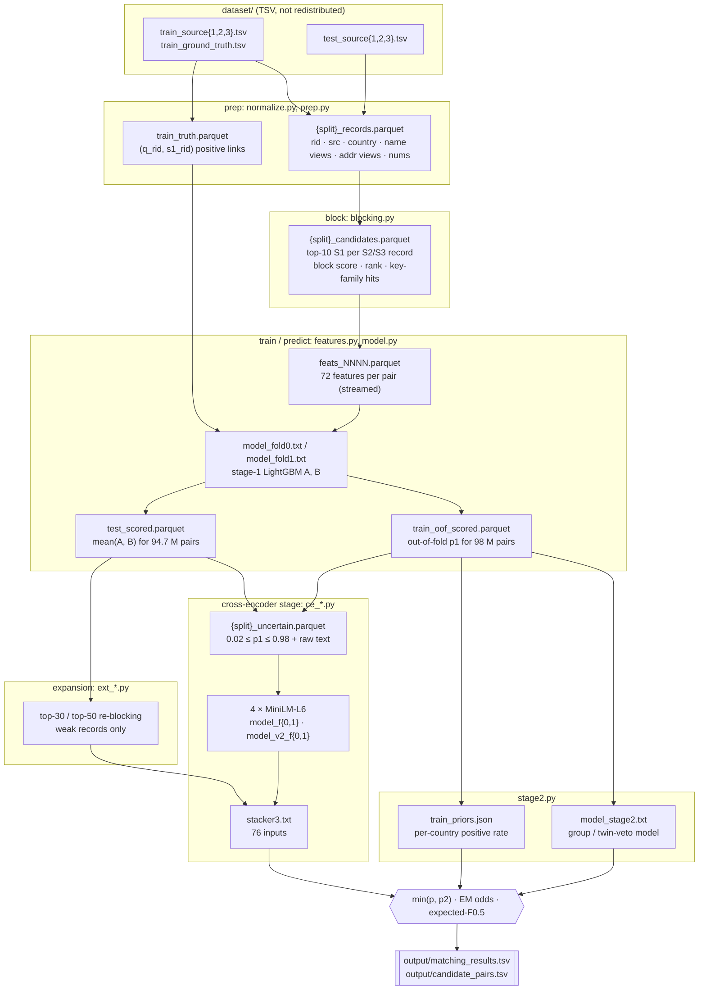
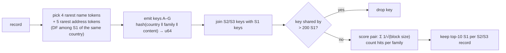
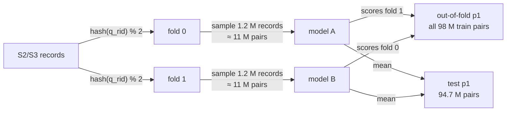
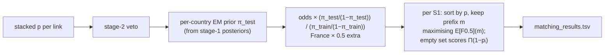

# System architecture

This document describes how the pipeline is put together: the components, the data that flows between
them, the cross-fitting scheme that keeps every stage honest, and the engineering that lets about 24 M records
fit through a 16 GB laptop. For the *why* behind each modelling choice, see [`SOLUTION.md`](SOLUTION.md).
For the numbers, see [`RESULTS.md`](RESULTS.md).

---

## 1. Design principles

1. **Recall first, precision last.** Cheap stages must never lose a true pair. Expensive stages exist to remove wrong ones.
2. **Cascade by cost.** Each model is roughly 10–100× more expensive per item than the one before it and sees 10–100× fewer items.
3. **Exploit the structure.** Every S2/S3 record belongs to *at most one* S1 entity, and a real entity's records agree with each other.
   Both facts are turned into features (competition, consensus) and decision rules (one best S1 per record, group veto).
4. **Honest scores everywhere.** No model ever scores rows it was trained on. All training data for later stages comes from
   out-of-fold predictions.
5. **Safe under shift.** The test set has an unseen country and more look-alike distractors. Rules that only *remove* links
   (veto, calibration downward) transfer; rules that *add* links do not.
6. **Country-agnostic.** The country label only scopes blocking keys (as an opaque string). There is no country feature
   and no hard-coded country list, so `France` flows through the same code path as `US` and `India`.

---

## 2. End-to-end data flow

All intermediate tables live in `work/` (configurable with `ER_WORK_DIR`) as zstd-compressed Parquet. Records are referred to
by a dense integer `rid` (UInt32) instead of string IDs. `q_rid` is an S2/S3 "query" record and `s1_rid` a Source-1 entity.

---

## 3. Components

### 3.1 Normalisation (`normalize.py`, `prep.py`)

| Input | Output view | Used by |
|---|---|---|
| business name | core tokens (legal forms canonicalised, stop words and domains stripped) | blocking A/B/F, TF-IDF, fuzzy features |
| business name | concatenated core name (no spaces) | blocking D, Jaro-Winkler (domains, glued names) |
| business name | phonetic consonant skeleton | blocking A/E, skeleton similarity |
| business name | legal-form category | legal-form agreement / conflict features |
| address | canonical tokens (abbreviations, state codes, ordinals) | blocking C/F/G, address features |
| address | list of house numbers (leading zeros removed) | blocking B/C, digit-position features, stage 2 |
| both | script flag (non-Latin input) | feature |

Non-ASCII strings are transliterated with `anyascii`, a deterministic character table, which means no external
service is involved. Digit-in-word tokens are OCR-repaired (`0→o, 1→l, 3→e, 4→a, 5→s, 7→t, 8→b`). The step takes ≈ 3.5 minutes for both splits.

### 3.2 Blocking (`blocking.py`)

* **Linear cost:** keys are scoped per country and capped at 200 S1 records, so block sizes are bounded and no step is quadratic.
* **Stability under noise:** choosing the *rarest* tokens means that reordering or injecting generic words (`Center`, `Services`)
  does not change a record's keys.
* **Output:** train 98.0 M pairs (≈ 9.5 per S2/S3 record); test 94.7 M pairs (≈ 55 per S1 entity). Each pair carries the block score,
  its rank, and seven per-family hit counts, which become model features.
* **Measured recall** (500 k training queries): key hit 98.7 %, recall@10 97.9 %, recall@1 95.1 %.

### 3.3 Stage-1 pair model (`features.py`, `model.py`, `run_pipeline.py`)

Candidate pairs are **streamed by `q_rid` range**, so each chunk holds complete candidate groups and the
per-record competition features (gap to best, margin over second best, candidate count) can be computed inside the chunk.

LightGBM binary objective, 127 leaves, learning rate 0.05, early stopping. After scoring, `assign` keeps each record's
single best S1 and **learned pruning** drops it if p1 < 0.02. This pruned set (6,595,983 test pairs) is exactly
what every later model runs on, so it is what `candidate_pairs.tsv` contains.

### 3.4 Validation protocol

S1 entities with `hash(id) % 40 == 0` (or a 20 % hash split for the stage-2 / stacker evaluations, 441,785 S1) are
held out. **Every** S2/S3 record that has a held-out entity as a candidate *or* as its true match is scored with its
full candidate list, so false merges into held-out entities are counted exactly as the official metric would count them.
Training uses only records that never touch a held-out entity. Singletons are included.

### 3.5 Cross-encoder stage (`ce_export.py` → `ce_predict.py`)

| Script | Role | Output |
|---|---|---|
| `ce_export.py` | best-attachment pairs with 0.02 ≤ p1 ≤ 0.98, raw `name \| address` text for both sides, fold id | `ce/{train,test}_uncertain.parquet` (887 k / 1.11 M pairs) |
| `ce_prep_eval.py` | held-out stage-2 scores and the out-of-fold row index | `ce/rows_oof.parquet`, `ce/heldout_p2_v6.parquet` |
| `ce_uncertain_features.py` | re-attach the 72 stage-1 features to uncertain pairs | `ce/{split}_uncertain_feats.parquet` |
| `ce_train.py` | fine-tune MiniLM-L6 per fold (90 k or 220 k pairs, max 80 tokens, AdamW 3e-5, one-cycle, 1 epoch, fp16 on GPU) | `ce/model_f{0,1}`, `ce/model_v2_f{0,1}` |
| `ce_score.py` | out-of-fold scores for train, fold-averaged scores for test | `ce/*oof_ce_*.parquet`, `ce/*test_ce_*.parquet` |
| `ce_stack_train.py` | LightGBM stacker on `[logit p1, margin, logit CE_v8, logit CE_v7] + 72 features` | `ce/stacker3.txt`, `ce/stacker3_cols.json` |
| `ce_predict.py` | stack → stage-2 veto → EM calibration → expected-F0.5 → TSVs | `output/*.tsv`, `ce/test_final_p.parquet` |

The cross-encoder reads characters, not features, so it can learn patterns the hand-built features miss, such as which kinds
of edits are typical noise and which mark a different business. Restricting it to the uncertain band keeps the CPU cost at
about 10 hours instead of weeks.

### 3.6 Stage 2: group model (`stage2.py`)

For each S1 entity, the group is all S2/S3 records that chose it as their best S1. For every member, the model computes:

* `g_twin_num`: how many *other* members share this record's house number while it disagrees with the S1's number
* support for the S1's own number (member count and probability mass)
* exact name and address agreement counts across the group
* best probability among members sharing this record's number
* consensus among confident members, group size, sum and max of the other members' probabilities
* rank and relative probability inside the group

A LightGBM model (63 leaves, 27 features) trained on out-of-fold groups of all 2.2 M training S1 entities outputs `p2`.
The combination rule is deliberately asymmetric:

| Country | Rule |
|---|---|
| seen in training (US, India) | `p = min(p, p2)` only if `p2 < 0.1` (soft veto), else `p` |
| unseen (France, or any new label) | `p = min(p, p2)` (full veto) |

### 3.7 Decision layer (`model.py`)

* `em_prior` implements the Saerens–Latinne–Decaestecker EM algorithm for prior shift. It uses only the model's test
  posteriors, no labels. Factors are always estimated on **stage-1** scores, the scores the training priors were measured on.
* `select_sets` evaluates every prefix size per entity in one vectorised Polars pass.

### 3.8 Targeted candidate expansion (`ext_*.py`)

| Script | Role |
|---|---|
| `ext_expand_block.py` | re-run key blocking to top-30 for weak records (best p1 < 0.5): ranks 11–30 |
| `ext_expand_block_in50.py` | same to top-50 for weak India records: ranks 11–50 |
| `ext_score.py` | stage-1 re-scoring of the expanded groups (streamed, resumable; `EXT_TAG=50` for the India pass) |
| `ext_merge50.py` | India records take the rank 11–50 expansion |
| `ext_phase1.py` | new best S1 per record; export pairs whose best changed and are uncertain |
| `ext_phase2.sh` | the four cross-encoders on the changed pairs (out-of-fold on train) |
| `ext_phase3.py` | `eval`: held-out macro F0.5 with vs without expansion; `build <dir>`: final TSVs |

Only records whose best S1 *changed* get new inputs. Every other record keeps its exact previous inputs, so the
held-out difference measures the expansion alone.

---

## 4. Resource engineering

| Concern | Technique |
|---|---|
| 16 GB RAM | chunking by `q_rid` range (1 M records for blocking/features, 400 k for streaming); Parquet + zstd; u64 keys; UInt32 ids; never two memory-heavy stages at once |
| ≈ 100 M pairs per split | features computed per chunk and written as `feats_NNNN.parquet` / `scored_NNNN.parquet` parts |
| No GPU | transformer only on the uncertain 1–2 % of pairs; 22.7 M-parameter model; max length 80 tokens |
| Crashes during overnight runs | every stage is idempotent and skipped when its artefact exists; the expansion scorer resumes mid-stream |
| Reproducibility | fixed seeds (42 for the pipeline, fold-seeded cross-encoders), pinned dependencies, hash-based folds |

Measured on an Intel Core i7-1355U (10 cores / 12 threads), 16 GB RAM, no GPU:

| Stage | Wall time |
|---|---|
| normalisation (both splits) | ≈ 3.5 min |
| blocking | ≈ 38 min per split |
| stage-1 training, out-of-fold scoring of 98 M pairs, stage 2 | ≈ 97 min |
| test scoring (2-model ensemble) | ≈ 107 min |
| cross-encoder stage (4 models, train + test scoring) | ≈ 10–12 h (≈ 30–60 min on one GPU) |
| peak RAM | ≈ 9 GB |

---

## 5. Configuration

`src/config.py` holds all constants. Paths can be overridden with environment variables:

| Variable | Default | Meaning |
|---|---|---|
| `ER_DATA_DIR` (or `--data-dir`) | `./data` | folder with `train/` and `test/` |
| `ER_WORK_DIR` | `./work` | cache of intermediate artefacts |
| `ER_OUTPUT_DIR` | `./output` | final TSVs |
| `ER_EXTRA_FACTORS` | `{}` | extra per-country odds factors for the decision layer, e.g. `'{"France": 0.5}'` |

| Constant | Value | Meaning |
|---|---|---|
| `MAX_S1_PER_KEY` | 200 | drop blocking keys shared by more S1 records |
| `TOP_K` | 10 | S1 candidates kept per S2/S3 record |
| `QUERY_CHUNK` | 1,000,000 | records per blocking / feature chunk |
| `TRAIN_QUERIES_PER_FOLD` | 1,200,000 | sampled training records per cross-fitting fold |
| `SEED` | 42 | global seed |
