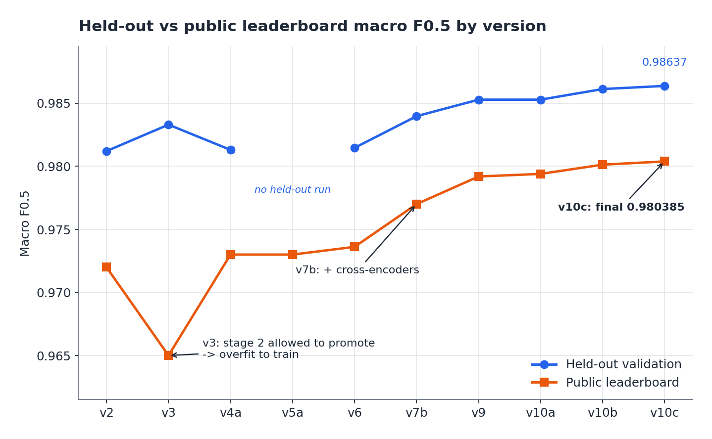
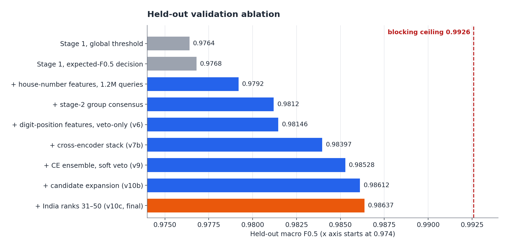
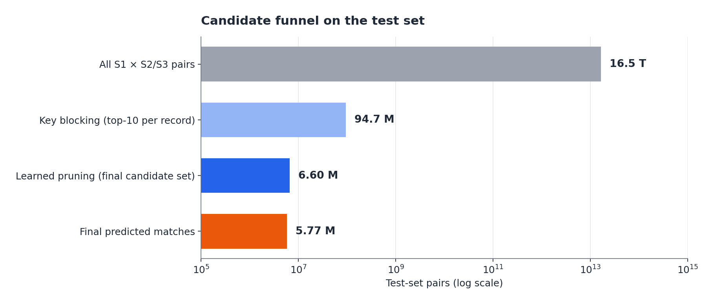
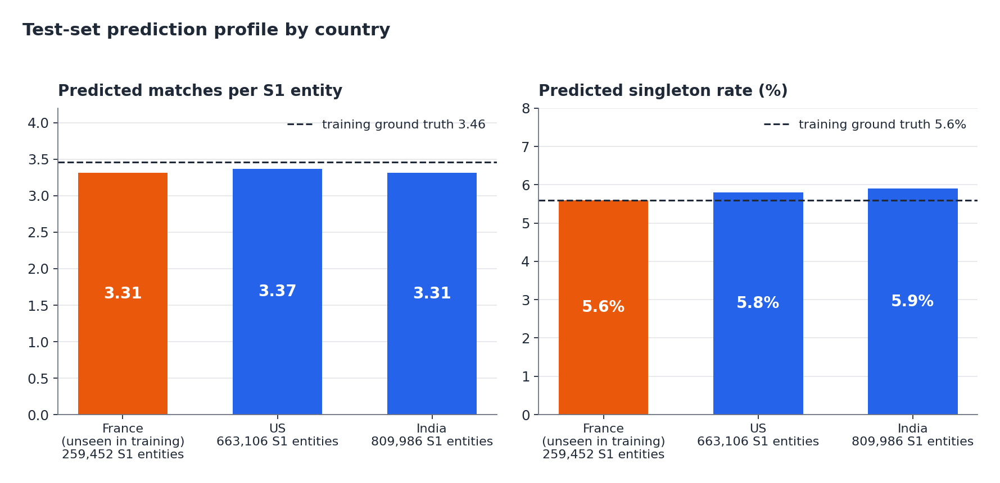
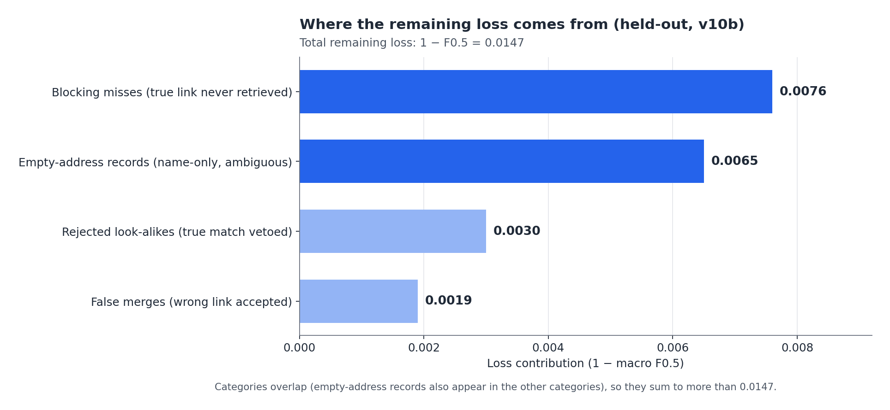
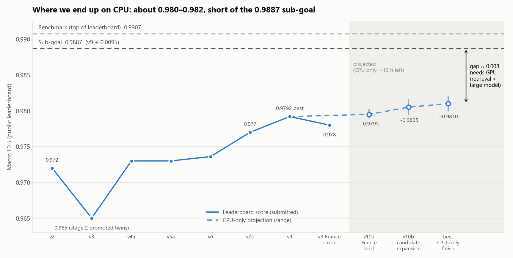

# Results

Every number below comes from our own held-out validation (training data the models never saw) or from the
challenge's public leaderboard. The metric is always **macro F0.5 per Source-1 entity, with singletons included**:

```
F0.5 = 1.25 · P · R / (0.25 · P + R)      per S1 entity, then averaged over all S1 entities
```

An entity with no true matches scores 1.0 for an empty prediction and 0.0 for any prediction.

---

## 1. Headline

| Measure | Value |
|---|---|
| Public leaderboard, final submission (v10c) | **0.980385** |
| Held-out macro F0.5, final pipeline (441,785 S1 entities) | **0.98637** |
| … US / India | 0.98860 / 0.98302 |
| Blocking ceiling (perfect matcher on our candidates) | 0.9926 |
| Test candidate pairs | 6,595,983 (3.81 per S1 entity) |
| Test predicted links | 5,772,673 |
| Official validator (`--check-ids`) | PASS |

---

## 2. Version history (held-out vs leaderboard)



| Version | Change | Held-out F0.5 | Public LB | Δ LB |
|---|---|---|---|---|
| v2 | numeric house-number features, stage-2 consensus, expected-F rule | 0.9812 | 0.972 | – |
| v3 | 2-fold cross-fitting, twin features; stage 2 allowed to **promote** | 0.9833 | 0.965 | −0.007 |
| v4a | stage 2 as a **veto only**, min(p1, p2); learned pruning to 3.8 candidates/S1 | 0.9813 | 0.973 | +0.008 |
| v5a | per-country EM label-shift calibration | – | 0.973 | 0 |
| v6 | digit-position house-number edit features | 0.98146 | 0.973612 | +0.0006 |
| v7b | + cross-encoder (90 k pairs/fold) + 75-input stacker | 0.98397 | 0.977 | +0.0034 |
| v9 | + 220 k-pair cross-encoders, v7+v8 ensemble; soft veto in US/India | 0.98528 | 0.979189 | +0.0022 |
| probe | soft veto also for France | – | 0.978 | −0.0012 |
| v10a | v9 + stricter France calibration (odds ×0.5) | 0.98528 | 0.979396 | +0.0002 |
| v10b | + top-30 blocking for weak records, expanded groups re-scored end to end | 0.98612 | 0.980128 | +0.0007 |
| probe | v10b with India / US odds ×0.7 | – | 0.980022 / 0.980105 | −0.0001 / −0.00002 |
| **v10c** | **+ India ranks 31–50 (final)** | **0.98637** | **0.980385** | +0.0003 |

**The validation-to-leaderboard gap** (≈ 0.006) comes from distribution shift, not from overfitting to the validation split.
The test set holds about 40 % distractor records against 26 % in training, 1.6× more mid-confidence records, and a whole
country with no training data. Changes that only remove links (veto, stricter calibration) carried over to the test set.
The one change that added links (v3) did not.

---

## 3. Ablation on held-out data



| Configuration | Held-out macro F0.5 |
|---|---|
| Blocking ceiling | 0.9926 |
| Stage 1, best global threshold (0.64) | 0.9764 |
| Stage 1, expected-F0.5 decision | 0.9768 |
| + numeric house-number features, 1.2 M training queries (global threshold 0.66) | 0.9791 |
| + expected-F0.5 decision | 0.9792 |
| + stage-2 group consensus (confident members only, 98 k training rows) | 0.9812 |
| v3: OCR repair + 2-fold cross-fitted stage 1, out-of-fold over all 2.2 M S1 | 0.9795 |
| v3: + stage 2 with twin features trained on all out-of-fold groups | 0.9833 |
| v4: stage 2 as veto only, min(p1, p2) | 0.9813 |
| v6: + digit-position features | 0.98146 |
| v7b: + cross-encoder stack | 0.98397 |
| v8 alone: 220 k-pair cross-encoders, full veto | 0.98429 |
| v9: v7 + v8 ensemble, soft veto | 0.98528 |
| v10b: + candidate expansion | 0.98612 |
| **v10c: + India ranks 31–50** | **0.98637** |

Cross-encoder effect on the uncertain band (0.02 ≤ p1 ≤ 0.98): AUC **0.913 (stage 1) → 0.981 (stacked)**.
Going from 90 k to 220 k training pairs per fold raised the single-model AUC from 0.926 to 0.952.

Raw validation reports: [`../results/`](../results).

---

## 4. Candidate generation



| Measure | Value |
|---|---|
| Possible pairs on test (S1 × S2/S3) | ≈ 1.65 × 10¹³ |
| After key blocking, train | 98.0 M pairs (≈ 9.5 per S2/S3 record) |
| After key blocking, test | 94.7 M pairs (≈ 55 per S1 entity) |
| After learned pruning, test (= `candidate_pairs.tsv`) | **6,595,983 pairs = 3.81 per S1** (14× reduction; 99.99996 % of the cross product removed) |
| True links kept by the pruned set (train) | 96.97 % |
| Final pipeline recall (train) | 95.9 % |
| Key-hit recall / recall@10 / recall@1 (500 k train queries) | 98.7 % / 97.9 % / 95.1 % |
| Early design (name and number keys only) | 94.4 % recall |

**Why the candidate set cannot shrink further:** training data has 3.46 true links per S1 entity, and our set has 3.81,
so it sits 10 % above that floor, and 87.5 % of candidate pairs end up as final matches. A tighter cut deletes real matches:

| Pruning threshold | Candidates / S1 | Accepted test links lost |
|---|---|---|
| p ≥ 0.02 (used) | 3.81 | – |
| p ≥ 0.1 | 3.59 | 3,006 |
| p ≥ 0.5 | 3.40 | 30,074 |

---

## 5. Calibration under label shift

| Country | Train positive rate (best attachments) | Mean p1 on train | EM-estimated test rate | Odds factor applied |
|---|---|---|---|---|
| US | 0.951 | 0.950 | 0.914 | × 0.55 |
| India | 0.931 | 0.929 | 0.873 | × 0.51 |
| France (unseen) | pooled 0.943 | – | 0.891 | × 0.50, then × 0.5 extra |

The model is well calibrated in training, and EM detects that the test set has fewer true matches among the best
attachments. Exact priors used: [`../results/train_priors.json`](../results/train_priors.json).

---

## 6. Test-set prediction profile (final v10c)



| Country | S1 entities | Predicted links / S1 | Predicted singleton rate |
|---|---|---|---|
| France (unseen in training) | 259,452 | 3.31 | 5.6 % |
| US | 663,106 | 3.37 | 5.8 % |
| India | 809,986 | 3.31 | 5.9 % |
| Training ground truth | – | 3.46 | 5.6 % |

The unseen country's predictions look like the training countries', which shows no sign of systematic over- or under-merging.

---

## 7. Error analysis



Remaining loss on held-out data (v10b pipeline, 1 − F0.5 = 0.0147; the categories overlap):

| Source of loss | Share of 1 − F | What it looks like |
|---|---|---|
| Blocking misses | 0.0076 | true link never retrieved. Of these, ~43 % pair a typo'd, gibberish or DBA name with an empty or heavily truncated address |
| Empty-address records | 0.0065 | 97.7 % of them are true matches, but 49 % of S1 entities share their exact core name with another S1 in the same country |
| Rejected look-alikes | 0.0030 | true matches whose house number was also perturbed (`52` vs `54`), which the pair alone cannot tell from a distractor |
| False merges | 0.0019 | ~85 % are near-copy distractors (`402` vs `40`, `1811` vs `1812`) or generic names (`Board Aging`) with no address |

---

## 8. Feature importance (stage 1, by gain)

1. block-score margin over the second-best candidate
2. block rank
3. log house-number difference
4. block-score gap to the best candidate
5. number-set Jaccard
6. address token-set ratio (and its gap to the best candidate)
7. name skeleton ratio
8. legal-form equality
9. name IDF mass
10. name ratio, name TF-IDF cosine

Most of the top features are *relative*: they say how a candidate compares with its competitors, not how similar it is in absolute terms.

The stage-1 global-threshold curve is flat between 0.56 and 0.74 (± 0.0005), so the operating point is not fragile.
The expected-F0.5 rule needs no threshold at all.

---

## 9. CPU-only ceiling



Our projection put the CPU-only ceiling at about 0.980–0.982 on the leaderboard. The leaderboard benchmark was 0.990748.
Closing that gap needs GPU-scale dense retrieval (to fix the 0.0076 of blocking misses) and a larger cross-encoder.
We requested GPU quota, but it was never granted during the challenge.
